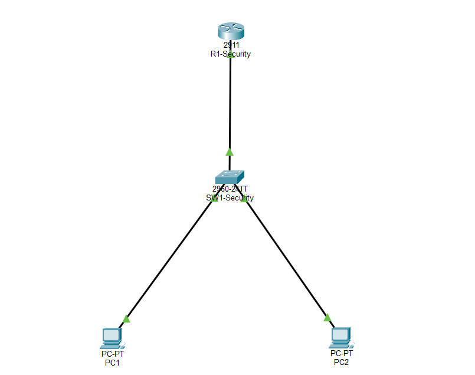
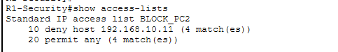
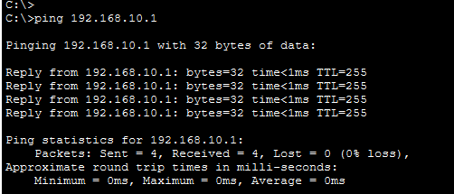
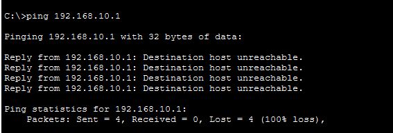
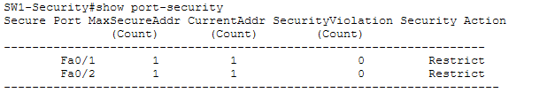
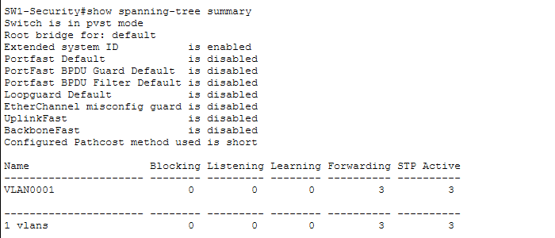
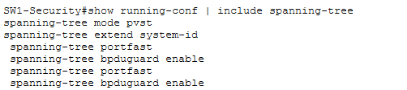
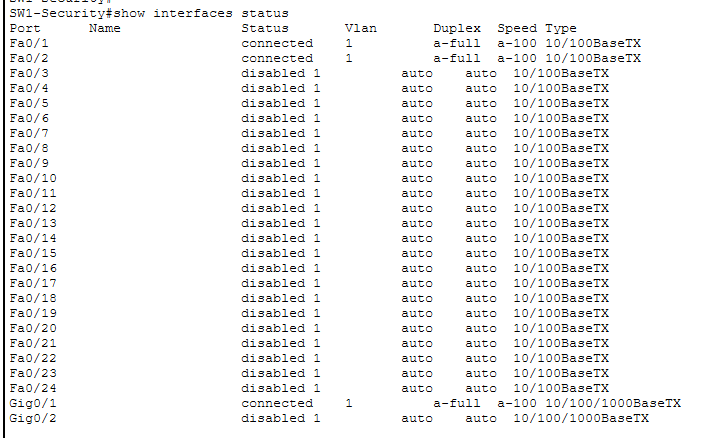

# Network Security Lab using Cisco Packet Tracer

## Project Overview

This project demonstrates basic network security configurations using Cisco Packet Tracer. It focuses on Access Control Lists (ACLs), Switch Port Security, and Spanning Tree Protocol (STP) protection.v

## Network Topology

The network consists of:
- 1 Cisco Router (2911)
- 1 Cisco Switch (2960)
- 2 PCs (PC1 and PC2)

## Security Configurations

### 1. Access Control Lists (ACLs)
- Configured a standard ACL named `BLOCK_PC2`.
- Denied traffic from host `192.168.10.11`.
- Permitted all other traffic.

### 2. Switch Port Security
- Enabled port security on switch access ports.
- Limited each port to one secure MAC address.
- Configured sticky MAC address learning.
- Set violation mode to Restrict.

### 3. Spanning Tree Protocol (STP)
- Verified PVST mode on the switch.
- Enabled PortFast on access ports.
- Enabled BPDU Guard to protect against unauthorized switches.
- Verified STP status using Cisco IOS commands.

## Verification
- Verified ACL configuration using `show access-lists`.
- Verified port security using `show port-security`.
- Checked interface status using `show interfaces status`.
- Saved configurations using `copy running-config startup-config`.

## Technologies Used
- Cisco Packet Tracer

## Project Screenshots

### 1. Network Topology

### 2. ACL Configuration

### 3. PC1 Connectivity Test (Allowed)

### 4. PC2 Connectivity Test (Blocked)

### 5. Switch Port Security

### 6. STP Verification

### 7. PortFast and BPDU Guard

### 8. Interface Status

- Cisco IOS
- Access Control Lists (ACLs)
- Switch Port Security
- PortFast and BPDU Guard
- Spanning Tree Protocol (PVST)
